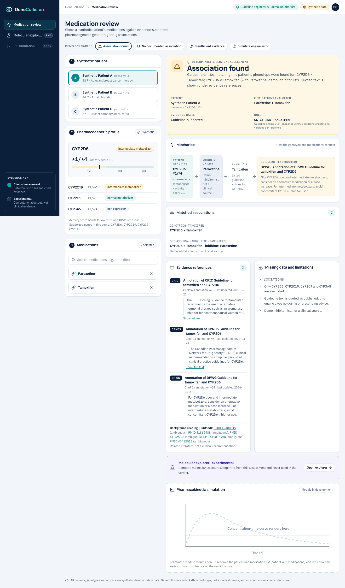
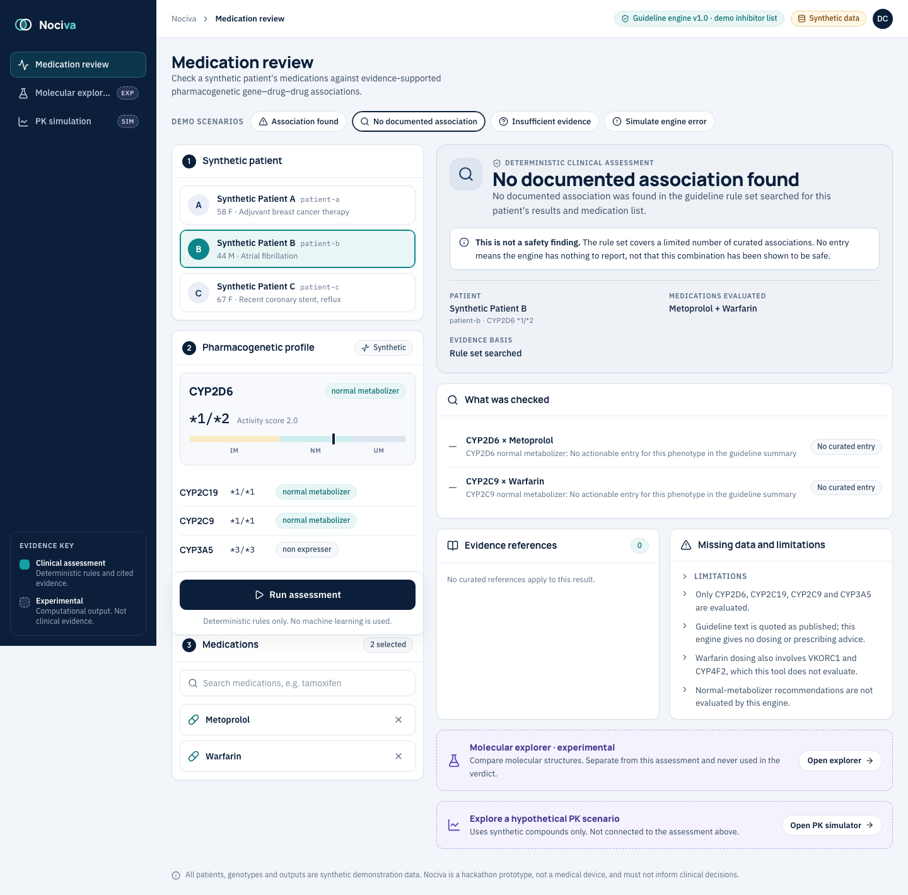
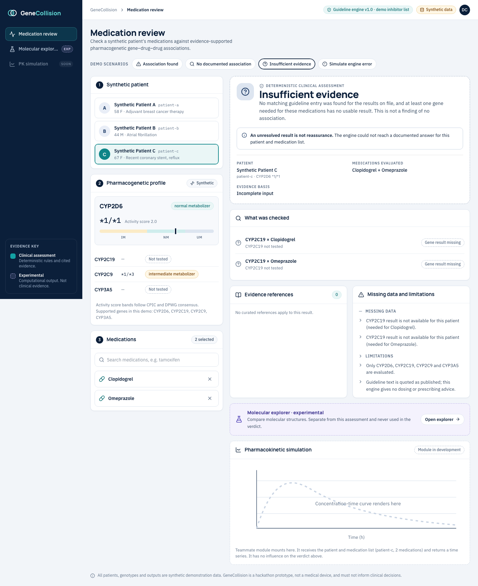

# GeneCollision

GeneCollision is a hackathon prototype that checks a patient's medication list against published pharmacogenomic guideline annotations and shows exactly which guideline text supports each finding. It also includes two separate, clearly experimental tools: a Molecular Explorer that compares a drug structure with a public CYP2D6 inhibition dataset, and a Pharmacokinetic Simulator that shows how a hypothetical change in clearance alters a predicted concentration curve.

## What the verdicts mean

The review engine returns one of three verdicts and never a score or a risk level. **Association found** means a guideline entry matches the patient's phenotype for one of the selected medications, and its text is quoted with source, version and date. **Insufficient evidence** means a gene needed for these medications has no result for the patient, so the engine refuses to assume "normal". **No documented association** means the engine searched its rule set and found nothing to report. It is not a safety finding: an empty result does not show that a combination is safe, only that this tool has nothing to say about it.

## Architecture

- **Frontend:** React + Vite in `frontend/`, with every backend response validated against a zod contract (`frontend/src/contracts/review.ts`).
- **Review engine:** `app/services/review_engine.py` reads the `guideline_rules` table (and `entity_relationships` for PubMed links) and is deterministic; it exposes `GET /api/v1/review/medications` and `POST /api/v1/review/assess`.
- **Molecular Explorer:** a RandomForest classifier over RDKit Morgan fingerprints plus Tanimoto nearest neighbours (`app/services/molecular/`, `ml/`), served at `/api/molecular/*`. It is experimental and never feeds the review verdict.
- **PK Simulator:** a closed-form one-compartment oral model with optional Monte Carlo variability (`app/services/pk/`), served at `/api/pk/*` and charted with Recharts. It uses synthetic compounds and user-supplied numbers, is not connected to any verdict, and is not clinically validated.
- **Supabase:** accessed read-only with SELECT queries only, using a publishable key; the client refuses `sb_secret` and `service_role` keys unless `ALLOW_PRIVILEGED_KEY=1` is set.
- **Backend:** one FastAPI app (`app/main.py`) shared with the team's original engine, which the UI does not use.
- **Tests:** `tests/` (pytest, no network or database) and `frontend/` (vitest).

The Molecular Explorer and the PK Simulator need no `.env`: without `SUPABASE_*` the backend still starts, logs "Supabase-backed routes disabled: .env missing", and serves `/api/molecular/*` and `/api/pk/*` only. The Medication Review live mode needs the `.env`.

## Quickstart (live mode)

From the repo root, with a Supabase project that holds the guideline data:

```bash
printf 'SUPABASE_URL=<your project url>\nSUPABASE_KEY=<publishable key>\n' > .env
./scripts/setup.sh        # venv, Python and npm deps, trains the molecular model (downloads a public dataset)
./scripts/dev.sh          # FastAPI on 127.0.0.1:8000 and Vite in live mode
open http://localhost:5173   # Vite prints the real port if 5173 is taken
.venv/bin/pytest tests && (cd frontend && npm test)
```

To see the UI with typed fixtures instead, with no backend or `.env`, run `cd frontend && npm install && npm run dev`. The topbar then reads "Demo fixtures, not a live engine". The PK page (`#/pk`) always calls the backend, so start it with `uvicorn app.main:app --port 8000` (no `.env` needed).

## Screenshots (live mode)





## Honesty and limitations

- Patients and genotypes are synthetic. Nothing here is a medical device or should inform clinical decisions.
- The inhibitor list (`app/data/cyp_inhibitors.json`) is a small demo list, not a clinical source, and is labelled that way wherever it is used.
- Guideline text is quoted as published, not interpreted. The engine matches phenotype words in the summary text and gives no dosing or prescribing advice.
- Only CYP2D6, CYP2C19, CYP2C9 and CYP3A5 are evaluated. Normal-metabolizer recommendations are not evaluated.
- Warfarin dosing also involves VKORC1 and CYP4F2, which this tool does not evaluate.
- The molecular model is research-grade and not clinical evidence. On its held-out scaffold-split test set it reaches AUPRC 0.704 against a positive-class prevalence of 0.235, and ROC-AUC 0.852.
- Related PubMed links are background reading and never change a verdict.
- The PK Simulator is a research demonstration: single oral dose, no real drug parameters, no covariate model, and the altered scenario is always hypothetical. Contextual inputs are echoed but never used in the calculation, and Monte Carlo bands are assumed demonstration distributions, not validated prediction intervals.

## Data sources and licences

Guideline annotations come from ClinPGx (formerly PharmGKB) and are stored in the project's Supabase tables. The molecular model is trained on the TDC CYP2D6_Veith dataset (CC BY 4.0). Package licences and the data-source notes are in [THIRD_PARTY.md](THIRD_PARTY.md); check ClinPGx's current terms before redistributing guideline text.

See [INTEGRATION.md](INTEGRATION.md) for the API contracts and [DEMO.md](DEMO.md) for a 3-minute walkthrough.

---

## Teammate API (legacy engine, not used by the UI)

The sections below are the team's original deterministic engine API under `/api/v1/evaluate` and `/api/v1/drugs/search`. The UI uses `/api/v1/review/*` instead.

### Running the application

#### 1. Create virtual python environment
- macOS/Linux
```
python3 -m venv venv
source venv/bin/activate
```

- windows(cmd)
```
python -m venv venv
venv\Scripts\activate.bat
```
- windows(powershell)
```
python -m venv venv
venv\Scripts\Activate.ps1
```
#### 2. Install dependencies
```
pip install --upgrade pip 
pip install -r requirements.txt
```
#### 3. Configure the virtual environments (.env)

```
SUPABASE_URL=XXX
SUPABASE_KEY=XXX
```

#### 4. Run using uvicorn
```
uvicorn app.main:app --reload --host 127.0.0.1 --port 8000
```
---

### Folder Structure
```
Nociva
├── README.md
├── app
│   ├── api
│   │   └── v1
│   │       ├── api.py
│   │       └── endpoints
│   │           ├── evaluate.py
│   │           └── search.py
│   ├── core
│   │   ├── config.py
│   │   └── database.py
│   ├── main.py
│   ├── models
│   │   └── evaluation.py
│   ├── repositories
│   │   ├── guideline_repo.py
│   │   ├── relation_repo.py
│   │   └── variant_repo.py
│   └── services
│       └── engine.py
└── requirements.txt

```

### API Endpoints, Request & Response Structures

#### 1. Endpoint 1: POST /api/v1/evaluate (The Core Engine)
- Purpose: Takes patient genotypes and a drug cocktail, runs the deterministic engine, and returns collisions and clinical guidelines.

Request Body Schema (Sample):
```
{
  "patient_id": "PT_99812",
  "patient_genotypes": {
    "CYP2D6": "Poor Metabolizer",
    "CYP2C9": "Normal Metabolizer"
  },
  "drug_cocktail": ["Codeine", "Citalopram"]
}
```
Response Body Schema (Sample):
```
{
  "evaluation_status": "CRITICAL_COLLISION",
  "input_drugs": ["Codeine", "Citalopram"],
  "detected_bottlenecks": [
    {
      "enzyme": "CYP2D6",
      "competing_drugs": ["Codeine", "Citalopram"],
      "patient_phenotype": "Poor Metabolizer",
      "risk_level": "CRITICAL",
      "mechanism": "Enzyme CYP2D6 is congested by 2 concurrent substrates while patient genetic capacity is 'Poor Metabolizer'."
    }
  ],
  "clinical_guidelines": [
    {
      "guideline_id": "PA166104931",
      "source": "CPIC",
      "recommendation_summary": "Avoid co-administration. Switch Codeine to an alternative analgesic not metabolized by CYP2D6."
    }
  ]
}
```
 ### 2. Endpoint 2: GET /api/v1/drugs/search

- Purpose: Allows frontend search bars to query available drugs and genes instantly.
- Query Parameters: ?q=code

Response Structure:
```
{
  "matches": ["Codeine", "Citalopram", "Clozapine"]
}
```
